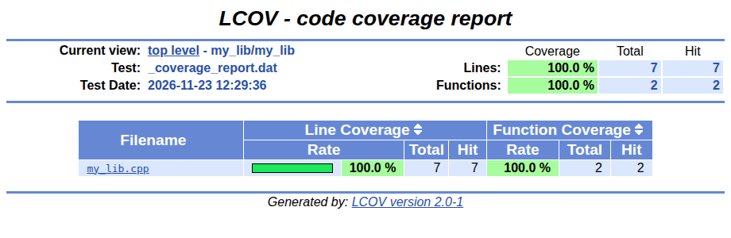

# Bazel C++ project template

This repository is the common setup I use for my Bazel-based C++ projects. It brings the build configs, coding guidelines, and automated checks so developers and AI coding agents can follow the same workflow.

## How changes are guided and checked

1. **Follow the project conventions.** The guidelines cover package layout, dependencies, C++ style, and Given/When/Then tests. The agent guide points coding agents to the rules and checks for each change. [Bazel guidelines](docs/Bazel-Guidelines.md) · [C++ guidelines](docs/Cpp-Guidelines.md) · [Agent guide](AGENTS.md)
2. **Get feedback locally.** Run the format checks and the tests for the targets you touched. The sample C++17 library and its GoogleTests show how to apply the conventions. [Local checks](#local-checks) · [Sample BUILD file](my_lib/BUILD)
3. **Review the change and its evidence.** CI runs Check → Build → Test → Coverage using the devcontainer image. Review the diff and the results, including the `coverage-html` report when relevant. [CI workflow](.github/workflows/unit_test_job.yml)

## Quick start

Use the Ubuntu 24.04 x86-64 devcontainer, or install GCC and Bazelisk as `bazel`. Bazelisk reads the Bazel 8 version from `.bazelversion`. The first run needs network access to fetch tools and dependencies. [Devcontainer tools](.devcontainer/Dockerfile)

From the repo root, build both profiles and run the tests.

```bash
./scripts/build_and_test/build_and_test.sh
```

## Adapt the template

- Rename the module in `MODULE.bazel` and replace `my_lib` with your packages.
- Use `--config=release` for optimized builds. Opt into `--config=warnings` for stricter compiler diagnostics or `--config=asan` for AddressSanitizer. Update the shared defaults and named profiles as your toolchains evolve. [Bazel configuration](.bazelrc)
- Update the guidelines, agent instructions, and CI commands together as your project adds new conventions or checks.

## Local checks

| Command                                                                   | Result                                                                 |
| ------------------------------------------------------------------------- | ---------------------------------------------------------------------- |
| `./scripts/check_and_fix/check_and_fix.sh`                              | Check C++, Bazel, and shell formatting. Pass `--fix` to apply edits. |
| `./scripts/build_and_test/build_and_test.sh test //my_lib:unit_test` | Run a single test target.                                              |
| `./scripts/check_and_fix/code_coverage.sh`                              | Generate `bazel-coverage/index.html`.                                |
| `./scripts/test_workflows.sh`                                          | Check developer script behavior.                                       |

Run `check_clang_format.sh`, `check_buildifier.sh`, or `check_shell_format.sh` under `scripts/check_and_fix/` to use one formatter at a time.

### Coverage report



## License

This template is released under the MIT License. [LICENSE](LICENSE)
